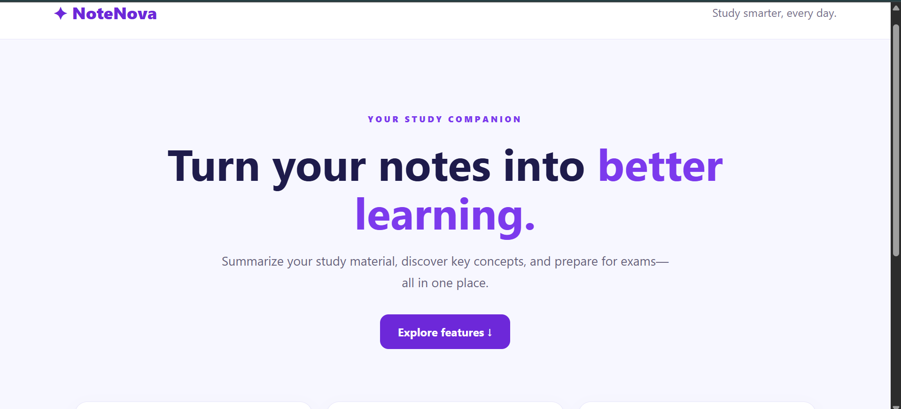
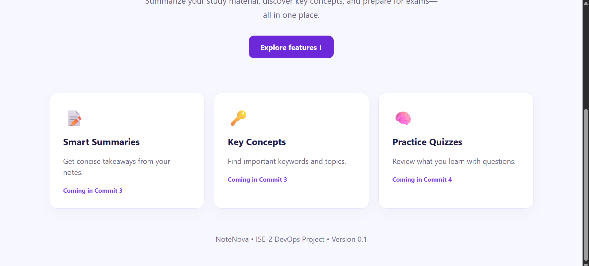
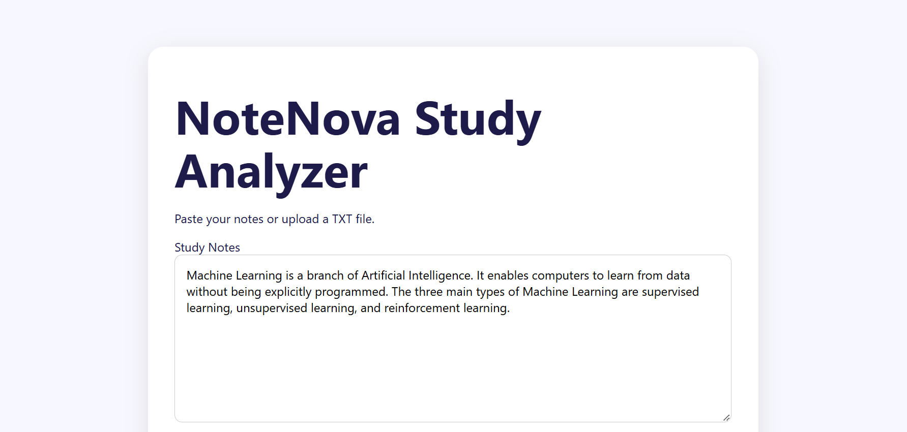
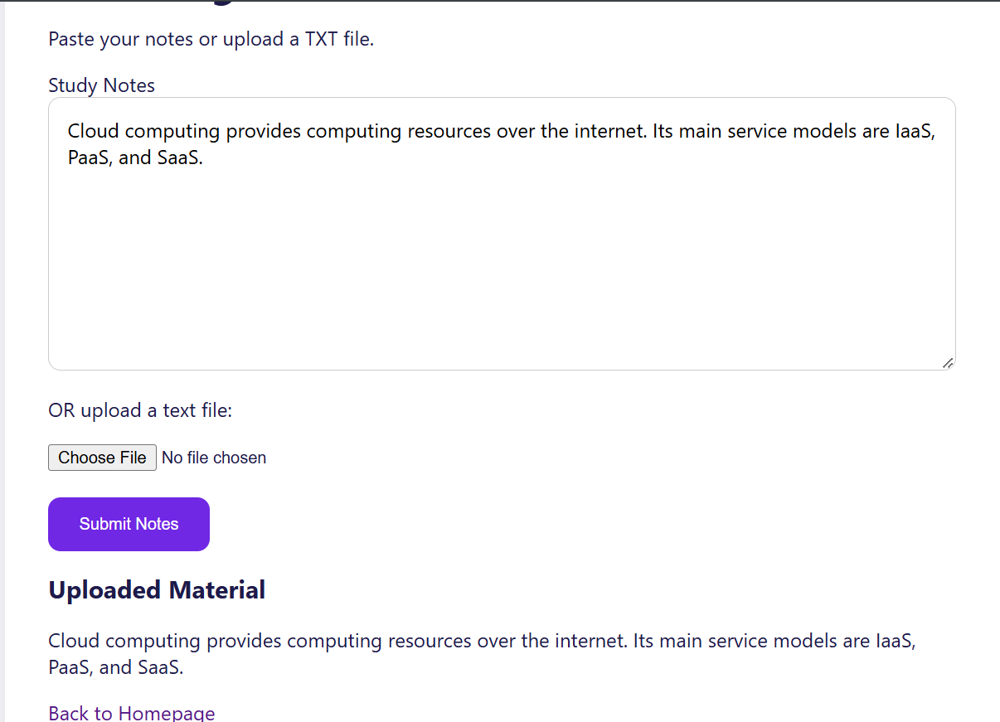
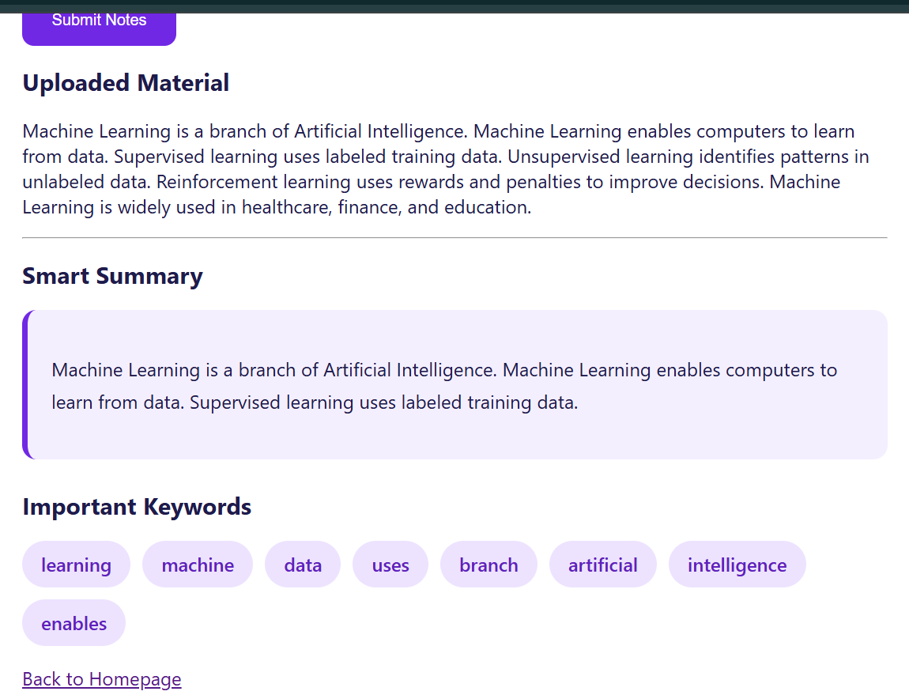
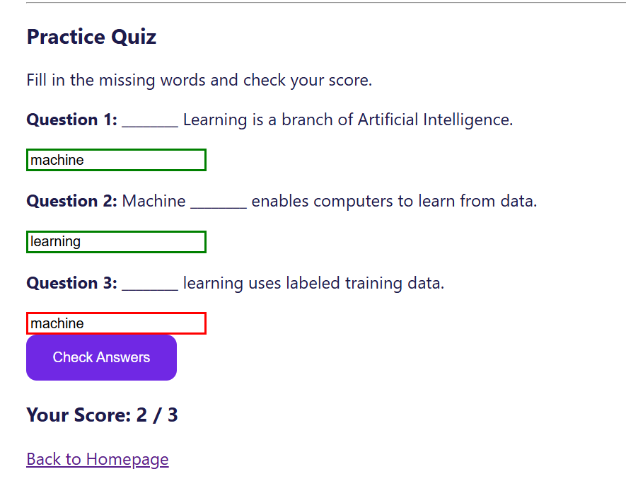
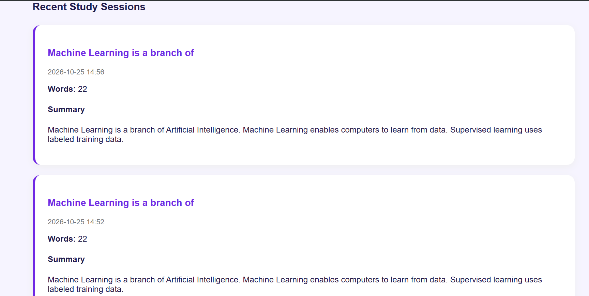
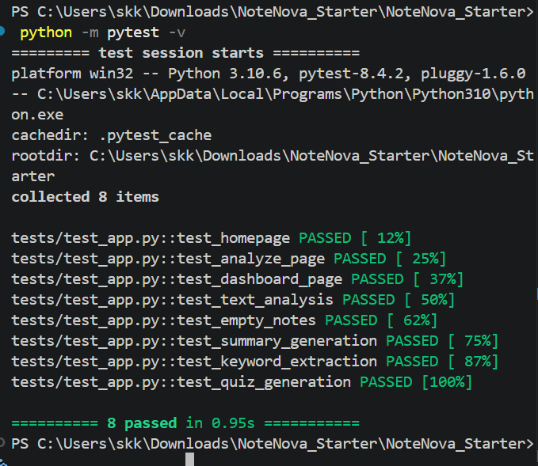
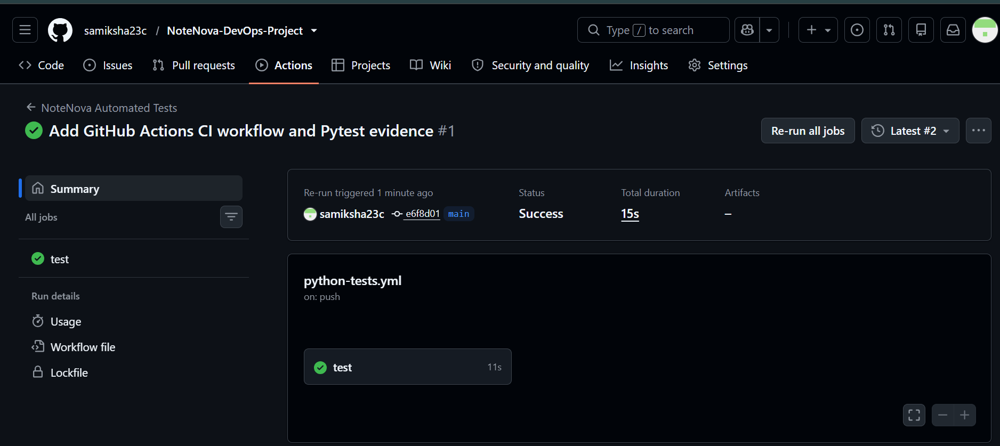
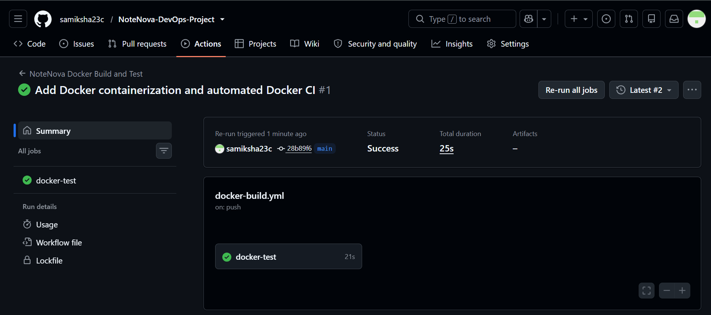

# NoteNova – Smart Study Material Analyzer

**A Flask-based smart study application with automated testing and GitHub Actions CI.**

## Project Overview

NoteNova is a student-focused web application designed to simplify studying by analyzing study material, generating summaries, extracting important keywords, and creating practice quizzes.

The application also includes an SQLite-based dashboard for viewing previous study sessions.

## Features

- **Study Material Input:** Enter study notes or upload TXT files.
- **Automatic Summarization:** Generate summaries from study material.
- **Keyword Extraction:** Identify important keywords.
- **Practice Quiz Generation:** Create quizzes from study notes.
- **Quiz Score Checking:** Evaluate quiz answers.
- **Study Dashboard:** View previous study sessions using SQLite.
- **Responsive Interface:** Access the application through a web browser.

## Technologies Used

| Technology | Purpose |
|---|---|
| Python | Backend programming |
| Flask | Web application framework |
| HTML and CSS | Frontend development |
| SQLite | Study session database |
| Git | Version control |
| GitHub | Source code hosting |
| Pytest | Automated testing |
| GitHub Actions | Continuous Integration |

## Project Structure

```text
NoteNova_Starter/
├── .github/
│   └── workflows/
│       └── python-tests.yml
├── screenshots/
├── static/
├── templates/
├── tests/
│   └── test_app.py
├── app.py
├── requirements.txt
└── README.md
```

## Installation and Setup

### 1. Clone the Repository

```bash
git clone https://github.com/samiksha23c/NoteNova-DevOps-Project.git
cd NoteNova-DevOps-Project
```

### 2. Create a Virtual Environment

```powershell
python -m venv .venv
```

Activate it in Windows PowerShell:

```powershell
.\.venv\Scripts\Activate.ps1
```

### 3. Install Dependencies

```powershell
python -m pip install -r requirements.txt
```

### 4. Run the Application

```powershell
python app.py
```

Open the application at:

http://127.0.0.1:5000

## Automated Testing Using Pytest

NoteNova includes eight automated tests covering:

1. Homepage
2. Analysis page
3. Dashboard
4. Text analysis
5. Empty notes validation
6. Summary generation
7. Keyword extraction
8. Quiz generation

Install Pytest:

```powershell
python -m pip install pytest
```

Run the tests:

```powershell
python -m pytest -v
```

**Local test result: 8 passed in 0.95 seconds.**

## Continuous Integration Using GitHub Actions

NoteNova uses GitHub Actions to automatically execute tests.

The CI workflow is located at:

`.github/workflows/python-tests.yml`

### CI Workflow

1. Developer pushes code to GitHub.
2. GitHub Actions starts an Ubuntu runner.
3. Python 3.10 is configured.
4. Project dependencies and Pytest are installed.
5. Automated tests are executed.
6. GitHub reports the workflow result.

**CI Status: Successful GitHub Actions workflow run.**

## Version Control

The project was developed incrementally using Git.

### Development History

1. Initial Flask website and responsive design.
2. Study material input and TXT file upload.
3. Automatic summarization and keyword extraction.
4. Practice quiz generation and score checking.
5. SQLite study dashboard and session history.
6. Automated Pytest tests.
7. GitHub Actions CI workflow and testing evidence.

## Screenshots

### 1. Homepage


### 2. Features


### 3. Study Material Input


### 4. TXT File Upload


### 5. Summary and Keyword Extraction


### 6. Quiz Generation


### 7. Study Dashboard


### 8. Pytest Results


### 9. GitHub Actions CI



## DevOps Implementation

The project demonstrates:

- Git-based source code management
- Incremental development through commits
- Automated software testing using Pytest
- Continuous Integration using GitHub Actions
- GitHub repository management
- Documentation and testing evidence

**Docker:** Container execution has not yet been verified.

## Docker Containerization

NoteNova supports Docker containerization using Python 3.10.

### Docker Configuration

- **Dockerfile:** Defines the container image and application startup.
- **.dockerignore:** Excludes unnecessary files from the image.
- **GitHub Actions:** Automatically builds and tests the Docker container.

### Docker Commands

Build the Docker image:

```bash
docker build -t notenova:latest .
```

Run the container:

```bash
docker run -d -p 5000:5000 --name notenova-container notenova:latest
```

Open the application at http://localhost:5000.

### Automated Docker Testing

The workflow `.github/workflows/docker-build.yml` performs the following operations:

1. Checks out the repository.
2. Builds the NoteNova Docker image.
3. Starts the Docker container.
4. Checks the Flask application's HTTP response.
5. Collects container logs.
6. Stops and removes the container.

**Result:** Docker build and container smoke test completed successfully using GitHub Actions.

### Docker Integration Screenshot



## Future Enhancements

- PDF study material support
- Advanced AI-based summarization
- Personalized quiz difficulty
- User authentication
- Cloud deployment
- Docker containerization

## Repository

https://github.com/samiksha23c/NoteNova-DevOps-Project

## Conclusion

NoteNova combines study material analysis with practical DevOps techniques. Git enables version tracking, Pytest verifies application functionality, and GitHub Actions automates testing whenever code is pushed to the repository.